<p align="center">
  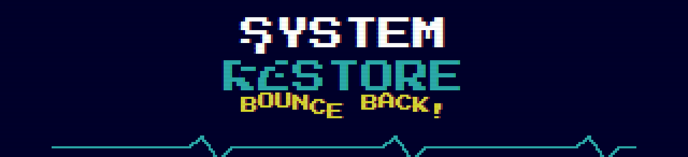
</p>

<h1 align="center">System Restore</h1>

<p align="center">
  <b>You are the recovery program inside a crashed computer. Fix the broken games. Bounce back.</b>
</p>

<p align="center">
  <a href="LICENSE"></a>
  
  
</p>

<p align="center">
  
  
  
  
  
  
  
  <a href="https://github.com/Venkat-sai-009/System-Restore/stargazers"></a>
  <a href="https://github.com/Venkat-sai-009/System-Restore/commits/main"></a>
</p>

<!-- Add the link to your itch.io page here once it is published. -->

<table>
  <tr>
    <td width="50%">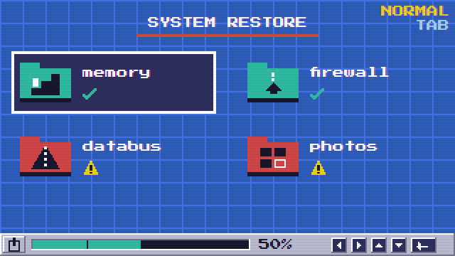</td>
    <td width="50%">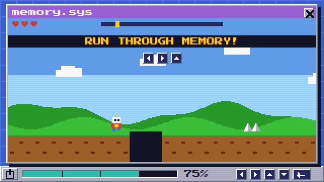</td>
  </tr>
</table>

## The story

<table>
  <tr>
    <td width="50%">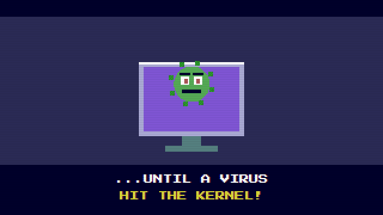</td>
    <td width="50%">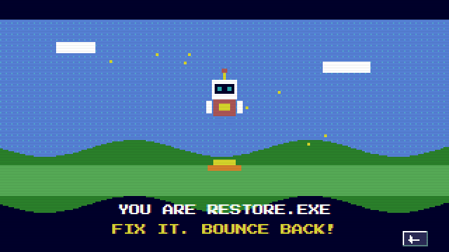</td>
  </tr>
</table>

A virus hit the kernel and the desktop split into corrupted sectors, each one a tiny game. You are
RESTORE.EXE. Repair a sector and the screen heals: integrity rises by 25%, more colour comes back
and the music gets fuller. At 100% the desktop collapses into the kernel, a maze-chase boss fight.

Beat it and a second story begins: the virus was only a copy, and the real one hides in the cloud.
The colours drain again and four new games open up, ending in a second boss and an epilogue.

The theme is literal in several ways. Computers bounce back by rebooting, and so do you. Pits bounce
you back out, shots ricochet, balls bounce, and every K.O. hands you a comeback bonus.

## Play

- Run it locally (see below) or host the `dist/` build on itch.io.
- No walls of text. Pictograms and key icons show what to do.
- **Levels for every age group.** Pick EASY (kids and new players: extra hearts, slower, more time),
  NORMAL or HARD (fewer hearts, faster, more to do) after the intro. Press Tab in the hub or on the
  K.O. screen to change it at any time.
- **Bounce back.** When your hearts run out you see a big K.O. Press Enter to retry with a small
  twist and a comeback bonus (an extra heart, a short shield or extra time), or Esc to return to the
  desktop. The hub counts your bounce-backs.

<table>
  <tr>
    <td width="50%">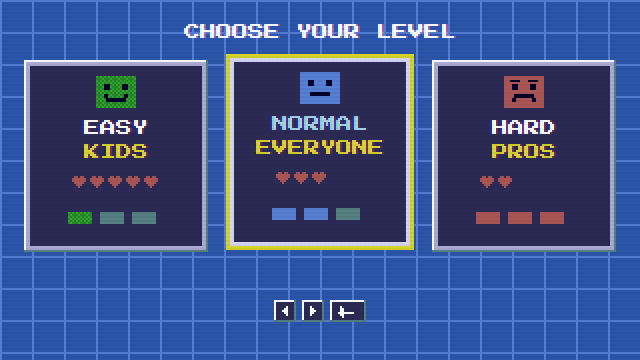</td>
    <td width="50%">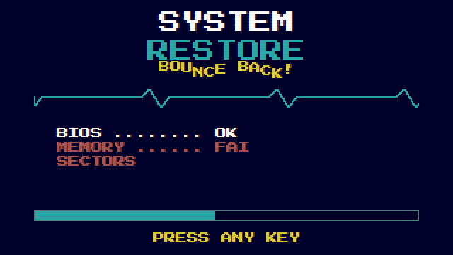</td>
  </tr>
</table>

## Corrupted rules

The system is broken, so the rules of each game glitch while it is damaged. A warning flashes, then
for a few seconds your controls flip, the screen mirrors or turns upside down, or the game rushes.
Every sector you repair makes the glitches rarer, and at 100% the rules are clean. The bosses always
glitch, because they cause the corruption. The first sector of a run is gentle, and a comeback bonus
after a K.O. removes one glitch.

## Controls

| Action | Keys |
| --- | --- |
| Move / select | Arrow keys or WASD |
| Jump / rapid fire / rotate / whack / confirm | Space or Enter |
| Close a sector | Esc |
| Change level | Tab (hub and K.O. screen) |
| Mute | M |

Mouse clicks work in the menus, the photo puzzle, bug whacking and flying. On touch screens,
on-screen buttons appear.

## Chapter 1: System Restore

| Folder | Genre | Goal |
| --- | --- | --- |
| memory | Platformer | Reach the flag. Pits bounce you back at the cost of a heart. |
| firewall | Shooter | Survive the swarm. Shots ricochet off the walls, and your weapon upgrades itself every 10 seconds. |
| databus | Pseudo-3D racer | Dodge the cones and finish before time runs out. A crash knocks you back. |
| photos | Rotate puzzle | Turn tiles until the photo matches the preview. |
| kernel | Boss | A maze chase: eat every data bit, dodge the viruses, grab power cores to eat them back. |

<table>
  <tr>
    <td width="33%"><br><sub><b>memory</b> platformer</sub></td>
    <td width="33%">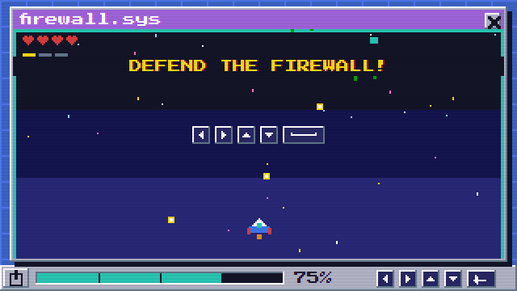<br><sub><b>firewall</b> ricochet shooter</sub></td>
    <td width="33%">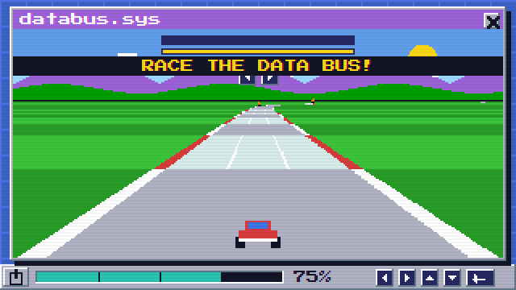<br><sub><b>databus</b> pseudo-3D racer</sub></td>
  </tr>
  <tr>
    <td width="33%">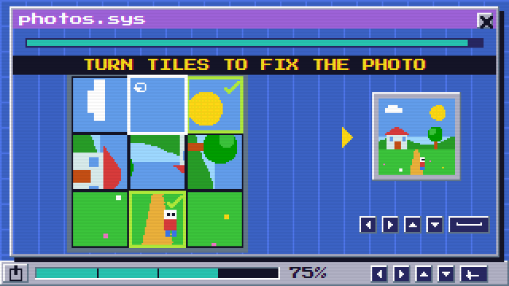<br><sub><b>photos</b> rotate puzzle</sub></td>
    <td width="33%">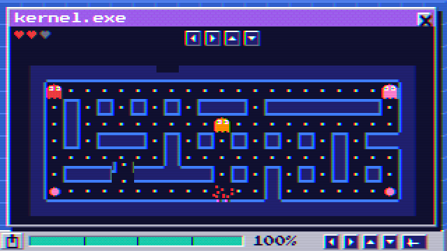<br><sub><b>kernel</b> maze-chase boss</sub></td>
    <td width="33%"></td>
  </tr>
</table>

## Chapter 2: Network Restore

| Folder | Genre | Goal |
| --- | --- | --- |
| cache | Breakout | Bounce the ball off your paddle and clear every brick. |
| network | Snake | Collect the data packets. You bounce off viruses and your own tail. |
| bugfix | Whack-a-bug | Whack the bugs and spare the yellow files. Orange bugs bounce back, so hit them twice. |
| wifi | Flappy-style flyer | Fly through the gaps. The floor and ceiling are trampolines. |
| cloud | Boss | A bigger storm maze with an extra virus. |

<table>
  <tr>
    <td width="33%">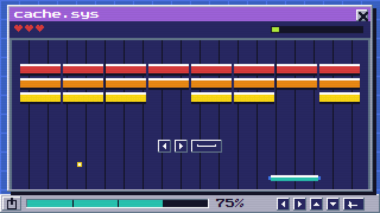<br><sub><b>cache</b> breakout</sub></td>
    <td width="33%">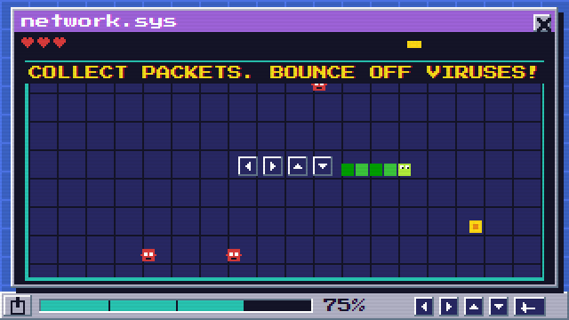<br><sub><b>network</b> snake</sub></td>
    <td width="33%">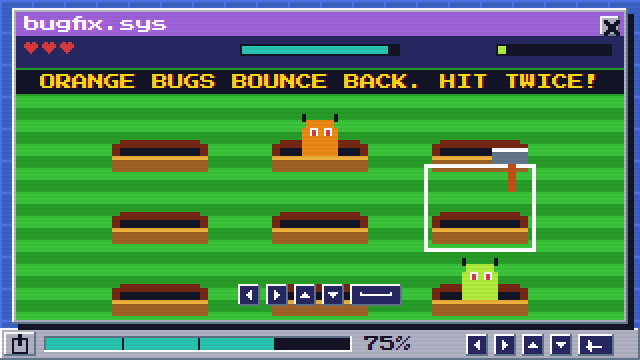<br><sub><b>bugfix</b> whack-a-bug</sub></td>
  </tr>
  <tr>
    <td width="33%">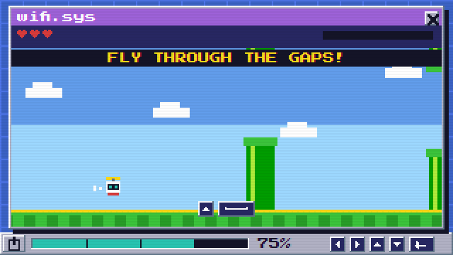<br><sub><b>wifi</b> flyer</sub></td>
    <td width="33%"></td>
    <td width="33%"></td>
  </tr>
</table>

Each retry after a K.O. changes something small, such as a new platformer layout, faster enemies,
more cones or a freshly generated maze.

## Run it

```bash
npm install
npm run dev        # local dev server
npm run build      # outputs to dist/
npm run preview    # test the production build
```

## Publish to itch.io

1. `npm run build`
2. Zip the **contents** of `dist/` so that `index.html` is at the zip root.
3. Upload the zip as an HTML5 project and tick "This file will be played in the browser".

`vite.config.js` sets `base: './'`, so asset paths are relative and work from any sub-path.

## How it works

- The game draws into a 320x180 canvas. three.js turns that canvas into a texture and runs a
  post-processing shader, then CSS scales it up with `image-rendering: pixelated`.
- **Heal-the-palette:** one `integrity` uniform drives the shader. At 0 the picture is muted with
  few colour levels. Each repaired sector unlocks more colour and saturation. Glitch effects play
  at boot, in the story, on bounce-backs and repairs, and stay faint the rest of the time.
- **Corrupted rules** live in `src/glitch.js`: a small scheduler that flips input, mirrors the
  screen or speeds up time, driven by the same integrity value.
- All sound is synthesized with the Web Audio API. Music layers (bass, drums, arpeggio, lead,
  pads) are added as sectors are restored. Audio starts only after the first key press or click.
- Every sector implements the same interface (`init`, `update`, `render`, `dispose`), see
  `src/sectors/`. Tunables live in `src/config.js`.
- Only best times and the chosen level are stored, in `localStorage`, wrapped in try/catch.

```
src/
  main.js game.js glitch.js state.js config.js
  render/   renderer.js postfx.js shaders/
  ui/       boot.js story.js storyArt.js difficulty.js overlays.js desktop.js window.js icons.js
  sectors/  platformer shooter racer puzzle breakout snake whack flappy pacman (.js)
  audio/    context.js sfx.js music.js
  utils/    input.js draw.js math.js particles.js
docs/img/   screenshots used in this README
```

## Credits and licence

- Code: MIT, see `LICENSE`.
- Font: [Press Start 2P](https://fonts.google.com/specimen/Press+Start+2P), SIL Open Font
  License 1.1, self-hosted in `src/assets/fonts/` with its licence text.
- All art and sound are drawn or synthesized in code. No third-party assets.
